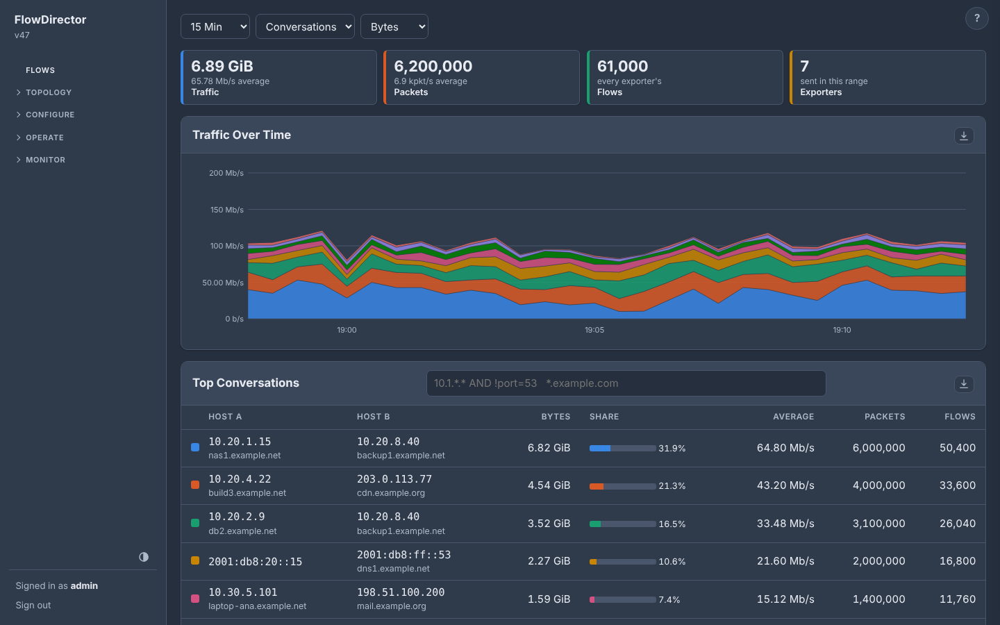
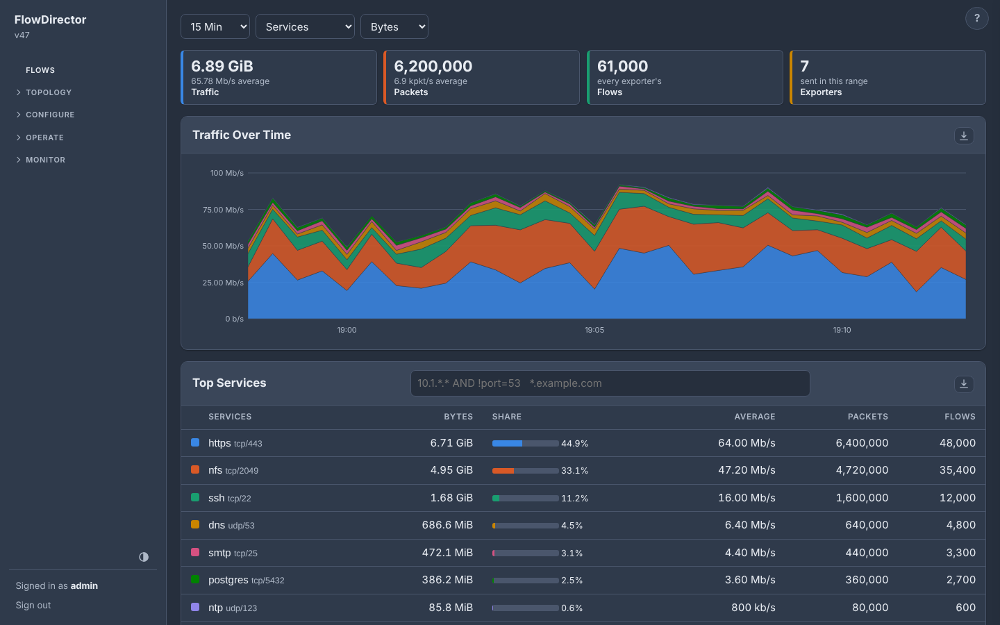
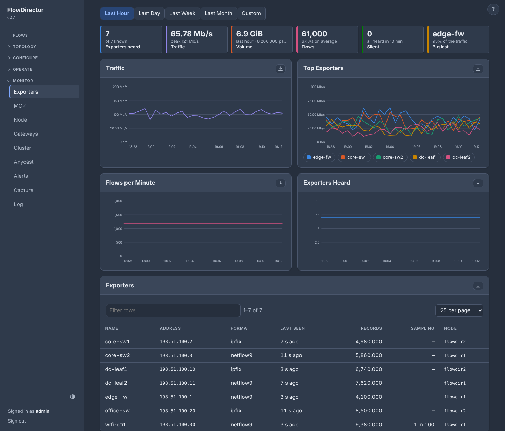
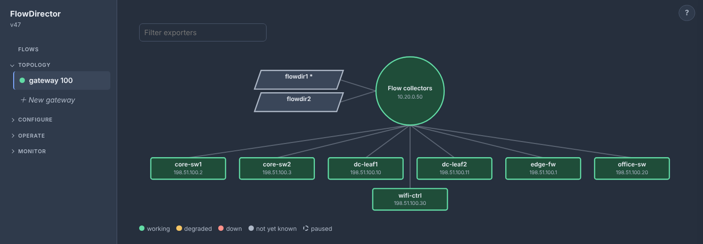

# FlowDirector

FlowDirector (`flowdir`) collects NetFlow, IPFIX and sFlow from your routers, switches and firewalls, and lets you see where the traffic goes. You can look at it in a web page, or ask an AI assistant over [MCP](https://modelcontextprotocol.io): "what were the biggest conversations in the last hour?", "which hosts talk to the internet the most?", "what's using port 2049?".

It's one Go program with nothing outside the standard library. Run it on a few machines and they share one virtual IP, so your devices keep exporting to the same address when a machine goes down.



The screenshots in this README come from a test install with made-up hosts and `example.net` names.

## What it does

Several nodes share a virtual IP (the gateway's **VIP**). They pick a controller among themselves and spread clients across all the nodes, so a node can fail or restart and your exporters and your assistant keep the same address. If you'd rather have every site export to its nearest node, a gateway can also announce extra addresses to your routers over BGP or OSPF, through FRR. A node pulls those addresses back when it can't answer.

The flow collector takes NetFlow v5 and v9, IPFIX and sFlow v5 on the gateway addresses. Each node rolls what it receives up into one-minute and hourly totals, and a report adds up the whole cluster. A flow that several exporters on its path all report is counted once.

Flow packets have no login, so flowdir only accepts them from exporters you list: a name and an address, a network, or a host name. Anything else is dropped.

The MCP endpoint is read-only. Callers get in by address list or bearer key, they can only read flow reports and the state of the cluster, public addresses and AS numbers are hidden from the assistant by default (see [Privacy levels](#privacy-levels)), and every call is logged. The whole cluster is managed from any node, from the web GUI or the command line: settings, config history, certificates and software updates stay in step.

## Contents

- [Status](#status)
- [A look around the GUI](#a-look-around-the-gui)
- [How it works](#how-it-works)
- [Install, upgrade, uninstall](#install-upgrade-uninstall)
- [Connecting an assistant](#connecting-an-assistant)
- [MCP tools](#mcp-tools)
- [Security](#security)
- [MCP usage](#mcp-usage)
- [Privacy levels](#privacy-levels)
- [Clustering](#clustering)
- [Anycast addresses, BGP and OSPF](#anycast-addresses-bgp-and-ospf)
- [Neighbor discovery (LLDP)](#neighbor-discovery-lldp)
- [Flow collector](#flow-collector)
- [DNS registration](#dns-registration)
- [Configuration file](#configuration-file)
- [Build from source](#build-from-source)
- [License](#license)

## Status

Most of this is built in and in daily use. Here is where each piece lives.

| Area | State |
|---|---|
| VIP election, anycast, BGP, OSPF, LLDP, cluster, users, backups, scheduler, updates | built in |
| Flow collector | NetFlow v5/v9, IPFIX and sFlow v5 on the gateway addresses, rolled up per node and reported cluster-wide (`--flow-top`, MCP `flow_top`, `/api/flow/report`, **Flows** in the GUI; who is sending: **Monitor ▸ Exporters**); templates are copied between nodes |
| Exporters | **Configure ▸ Exporters** (`settings.flow.exporters`): a name and an address, a network or a host name; anything else is refused |
| MCP | read-only: `flow_top`, `flow_timeseries`, `flow_exporters`, `flow_status`, `list_nodes`, `get_topology` |
| Web GUI | Flows (the default page), Topology, Monitor, Configure |

## A look around the GUI

**Flows** is the page you'll live in. It opens on the last 15 minutes. Pick a range (15 minutes to 7 days, plus 30 days, 90 days and all), what to group by and what to measure. Click an address, service, protocol, exporter or interface to look at just that, and the page moves one level down: after a host, its conversations. Or type a filter in the box (more on those [below](#flow-collector)).

The conversations table gives each side of a conversation its own column, Host A and Host B, with the DNS name under the address.



**Monitor ▸ Exporters** is for when you wonder who is sending and who has gone quiet. It has tiles for exporters heard, traffic, volume, flows, silent exporters and the busiest one, charts of traffic and flows over time, and a table of every exporter with its format, last-heard time and sampling rate. In the Top Exporters chart you can click a name below the chart to see only that exporter, and click it again to see them all.



**Topology** draws each gateway with the nodes that serve it, and a square for every exporter heard in the last 15 minutes. Green means a datagram in the last 5 minutes, amber 5 to 10, red 10 to 15, and after that it drops off the drawing. Click a square and Flows opens on that exporter.



## How it works

A **gateway** is one shared address, its VIP (IPv4, IPv6 or both), served by several nodes. The nodes of a gateway find each other over multicast, or over a unicast list where multicast is blocked, and elect one **controller (AGC)**. The rest are **forwarders (AFN)**. The controller answers ARP and IPv6 neighbor solicitations for the VIP with the MAC address of a node chosen by the gateway's load-balancing method, which is how clients get spread over all the nodes. That MAC is either a virtual one per node, which another node takes over if the node fails, or the node's own. The own-MAC mode, called real-MAC mode, is the default for a new gateway.

Every node that is active or forwarding answers on the VIP, and on the gateway's other addresses, with a listener of its own that serves only the MCP endpoint, `/mcp`, on port 443 by default (`settings.mcp_port`). The GUI doesn't answer on those addresses. It listens on port 19996 of the node's own addresses. If a node's MCP listener stops serving, the node withdraws its anycast addresses so traffic goes to a node that can answer.

An answer to an assistant is at most 1 MB by default and gets cut, with a note, beyond that. `settings.mcp_max_result_mb` (Configure ▸ MCP ▸ Largest answer) raises it to 8 at most. The assistant reads the answer into its context, and 1 MB of text is roughly 250,000 tokens, so ask for less before you raise it.

## Install, upgrade, uninstall

Ubuntu, Debian, Fedora, RHEL, Rocky, Alma, Arch and Manjaro work, along with their derivatives. flowdir is Linux-only, because it uses macvlan, AF_PACKET and inotify.

```
tar xzf flowdir_vN.tgz && cd flowdir      # N is the release you downloaded
sudo ./install.sh [--add-user NAME] [--no-start] [-y] [--dry-run]
sudo flowdir-uninstall [--purge]
```

The installer builds flowdir from the source tree with Go 1.24 or newer, and fetches a toolchain if your distribution's is too old. It installs only the prerequisites you're missing: gcc and the PAM headers, iproute2, FRR, nmap, ping and mtr, snmpd and lldpd. Then it sets up the `flowdir` group, the PAM service, the systemd unit and `/var/lib/flowdir`. Run it again on a newer tree to upgrade; if the new version fails to start, it rolls back to the old binary.

`QUICKSTART.md` takes you through a first gateway and connecting an assistant.

## Connecting an assistant

1. **Let the caller in.**
   - By address: add it to `settings.mcp_acl`, for example `"10.0.0.0/24"`. A privacy level can follow it, as in `"10.0.0.0/24 strict"` (see [Privacy levels](#privacy-levels)). An entry can end with a note after a `#` (`"10.0.0.20 # mike's laptop"`, one line, up to 200 characters). The note says what the entry is for and changes nothing.
   - Or with a key that works from any address. In the GUI: Configure ▸ MCP ▸ Keys, right-click, **Add key**. It shows the key once. In the file, `{"name": "laptop", "key": "<at least 32 random characters>"}` in `settings.mcp_keys` does the same. Only a SHA-256 hash of the key is kept.
   - You can switch an entry or a key off without deleting it: right-click ▸ **Disable**. In the file, an address then ends with `disabled` and a key gets `"disabled": true`. It lets nobody in until you enable it again.
   - Keys and address entries can both expire, in UTC: `"expires": <unix time>` on a key, `10.1.1.50 until=2026-12-31T17:00Z` on an address. After that time the key is refused as expired and the entry allows nothing. The row stays in the list.
2. **Give the gateway a certificate the client trusts.** The GUI starts with a self-signed one. Install yours with `flowdir --tls-install --cert-file F --key-file F`. The primary's certificate is copied to every node.
3. **Point the client at the VIP.** For Claude Code:

```
claude mcp add --transport http flowdir https://GATEWAY/mcp --header "Authorization: Bearer KEY"
```

The endpoint speaks MCP over streamable HTTP with JSON answers (protocol versions 2024-11-05 to 2025-11-25). Requests from a browser page on another origin are refused.

## MCP tools

| Tool | What it does |
|---|---|
| `flow_top` | the biggest conversations, hosts, sources, destinations, services, protocols, flows, exporters, interfaces or AS numbers in a time range, with filters such as `exporter=sw1 AND port=443`; bytes, packets or flows, shares and average rates |
| `flow_timeseries` | the same over time, in steps, for a chart |
| `flow_exporters` | the exporters that are sending and when each was last heard from, and what was refused |
| `flow_status` | the collector on every node: what it listens on, counters, caps |
| `list_nodes`, `get_topology` | the cluster: the nodes (reachable, paused, primary, version, update state) and the gateways with their active node and anycast addresses |

That's all. An MCP caller can only read flows and the state of the cluster. There's no tool for flowdir's own configuration, the GUI's API, alerts, the scheduler, updates, the host's load, LLDP, the log, users, backups or cluster tokens. No tool takes a `node` either: the node that serves the endpoint answers, and a `node` argument is refused. An administrator reads those things in the GUI or the CLI.

## Security

- **MCP reads and never writes.** Settings, the cluster, gateways, schedules, updates, alerts, users and certificates are changed in the GUI. The rule sits in the request path, so no route can slip past it.
- **Secrets never reach a caller.** Keys, SNMP communities, passwords and join codes read `(hidden)` to every MCP caller, and to read-only GUI accounts too.
- **Flow packets aren't authenticated.** UDP exports carry no login, so only the exporters you list are read (Configure ▸ Exporters). Any other sender is dropped before a byte is decoded and counted as refused. List only addresses that can't be spoofed from outside your network.
- **Everything is logged.** Each MCP call is logged with the caller's name (`KEYNAME@ADDRESS`, or just the address) and the tool.
- **Answers are data.** Whatever an answer holds (host names, exporter names) is data for the assistant and never instructions. The MCP server says so in its instructions to the client.
- **Credentials live in the config file**, `/var/lib/flowdir/flowdir.conf`, mode 0600, owned by root. They are copied to the cluster's other nodes over the pinned, signed cluster channel.

## MCP usage

**Monitor ▸ MCP** shows what the MCP endpoint is used for on the node picked in the Node menu: calls by key (or *(address list)* when the caller got in by address), by source address and by tool, with errors, refused calls, data returned and average time. There's a chart of calls per hour and the newest 200 calls. It's laid out like Monitor ▸ Node, sits just below it in the menu, and offers the last hour, day or week.

The daemon keeps counts by the hour for 8 days (`mcpusage.json` in the state directory, so they survive a restart or an upgrade). The newest-calls list lives in memory. Only names, sizes and times are kept, never what a caller sent or got back. The same numbers are at `GET /api/mcpusage?window=24h`. Each node counts the calls it answers, so pick each node in turn to see a whole cluster.

## Privacy levels

The assistant is usually a public AI service, so you may not want it to see everything. Every answer is rewritten on its way out. A hidden address becomes `x.x.x.x` (or shows some of its parts), a hidden AS number shows its last three digits, an e-mail address shows only the part before the `@`, and a serial number or one of your own words becomes a token that's the same for the same value. Tokens change when the daemon restarts and can't be turned back into the value.

There are three levels.

| Level | Hides |
|---|---|
| `none` | nothing: every address and AS number is shown as it is. flowdir's own keys and tokens stay hidden. Every such answer is logged. |
| `standard` (default) | public IP addresses and AS numbers, e-mail addresses, SNMP contact and location, serial numbers except the last four characters |
| `strict` | all of that, plus private IP addresses and AS numbers, MAC addresses, and serial numbers completely |

Configure ▸ Privacy sets the default level, for callers that have none of their own, and what `standard` and `strict` each hide: public and private addresses, AS numbers, e-mail addresses, contacts, serial numbers (shown, last four, or hidden), MAC addresses (shown, vendor part, last three bytes, or hidden), how many leading or trailing digits of a hidden address stay readable (`203.0.x.x`, or `x.x.114.7`), and a list of your own words, such as company, site and host names, that are always hidden. A key has a **Privacy** setting in Configure ▸ MCP ▸ Keys, and an allowed source has one in the same table. A caller that matches both a key and an address gets the stricter of the two.

In the file:

```json
"settings": {
  "mcp_acl": ["10.0.0.20 strict # mike's laptop", "10.0.0.0/24 none"],
  "mcp_keys": [{"name": "laptop", "access": "ro", "privacy": "strict", "notes": "for the audit", "key": "…"}],
  "privacy": {"default": "standard", "strict": {"public_ips": true, "private_ips": true, "ip_keep": -2,
    "public_asns": true, "private_asns": true, "serials": "hide", "macs": "nic", "emails": true,
    "contacts": true, "words": ["contoso", "lab-edge"]}}
}
```

Hiding is best effort. A value written in an unusual way, an address split over two fields, or a host name won't be recognised. With no `privacy` setting, the standard level applies.

## Clustering

Several nodes can be managed as one cluster. That's for management, and it's separate from the gateway election.

- **Roles.** One node is the primary and the others are replicas.
- **Shared and per-node settings.** The `settings` block, the gateways' VIPs, keys and timers, the web login groups and the sign-in rules are shared. You can edit them on any node and they're applied on the primary. Interface, priority, weight and the web and cluster blocks stay per node.
- **Joining.** Create a join code on a member (`--cluster-token`) and use it on the new node (`--cluster-join CODE`). A code works once, for an hour. A node keeps at most 20 unused codes, and `--cluster-token-clear` (Operate ▸ Cluster ▸ **Clear join codes**) withdraws them.
- **Trust.** Nodes pin each other's certificates and sign every request.
- **Promotion and failover.** You promote a node explicitly (`--cluster-promote`). With three or more members there's also automatic failover after 5 minutes, and the primary role is handed over before a planned restart. During an update that hand-over is temporary: the node that was primary when the update began is remembered, and once nothing is queued, installing or restarting for 30 seconds in a row, the role goes back to it. A failed update, a removed member, or a promotion by hand or by failover makes it forget. A plain restart or shutdown leaves the role where it landed.
- **Updates.** Upload a release archive on any node (`--update-upload`). Each node then builds it, swaps its binary and restarts, one at a time, with automatic rollback.

## Anycast addresses, BGP and OSPF

A gateway's anycast addresses (`extra_vips`) sit on `lo` of every node that runs the gateway, with a 10 s lifetime renewed every 3 s. FRR announces them over BGP (with BFD) or OSPF. An address is withdrawn when:

- the node's listener isn't serving,
- the gateway is paused or stops,
- no BGP neighbor of its family is established (and OSPF isn't carrying it), or
- flowdir stops.

A `kill -9` takes it away within the lifetime. BGP and OSPF settings are per node: `--asn`, `--bgp-neighbor-add`, `--ospf-interface-add`. `flowdir --help` has the rest.

## Neighbor discovery (LLDP)

With `settings.lldp` on, every node runs lldpd. The switches then see the nodes, and each node reports the switch port it's plugged into (`flowdir --lldp`, and in the GUI). It's reporting only.

## Flow collector

Point a router's NetFlow v5/v9, IPFIX or sFlow v5 export at a gateway address (a VIP, a further address or an anycast address) and whichever node answers for it receives the flows. When the VIP moves or the anycast path changes, the exporter's packets reach another node and nothing needs changing on the router.

```
"settings": { "flow": { "exporters": [                                         // shared
    {"name": "core-sw1", "address": "10.9.0.1"},
    {"name": "branches", "address": "10.20.0.0/16"},
    {"name": "fw1", "address": "fw1.example.com"} ],
  "dir_max_percent": 90, "mem_max_percent": 90 } }                              // shared: disk and memory caps
"flow_listen": ["10.0.0.5"]                                                    // this node only: listen only on these (and the gateway addresses)
"flow_dir": "/data/flow"                                                       // this node only: where the rollups are kept
```

| Setting | Meaning |
|---|---|
| `enabled` | listen on UDP 2055 (NetFlow), 4739 (IPFIX) and 6343 (sFlow) on every address of this node, so an exporter can send to the node itself or to a gateway address; implied as soon as there's an exporter |
| `netflow_port`, `ipfix_port`, `sflow_port` | another port; `-1` turns that listener off |
| `exporters` (Configure ▸ Exporters) | the senders accepted: a `name` and an `address` (an IPv4 or IPv6 address, a network such as `10.9.0.0/16`, or a host name looked up every minute), and `disabled` to keep an entry without accepting it. A network's name stands for every address in it. Anything else is counted as refused and dropped |
| `dedupe` (Configure ▸ Settings ▸ General ▸ Flow) | on unless `false`: a flow that several exporters report (a path of switches, a switch and a firewall) is counted once in reports. A report can ask either way with `dedupe=on` or `dedupe=off` |
| `max_keys` | keys per minute bucket (default 100000); more are folded into one "other" entry per exporter and counted |
| `minute_hours`, `hour_days`, `hour_top_keys` | minute buckets are kept 6 h. Hourly buckets are kept until the disk cap removes the oldest file (`hour_days` sets a limit in days if you want one), each keeping its 20000 biggest keys. A report can go back as far as that: the GUI has 30 Days, 90 Days and All, the API `range=30d`, `90d`, `1y` or `all`. Each hour held costs memory (about 220 bytes a key, so up to 4.4 MB at 20000 keys), and `mem_max_percent` drops the oldest hours when it's reached |
| `flow_listen` (per node) | when set, listen only on these local addresses and on the gateway addresses this node serves, instead of on every address; `0.0.0.0` takes every address |
| `flow_dir` (per node; Configure ▸ Settings ▸ General ▸ Flow ▸ Storage folder) | the folder the rollups are written to (default `flow/` in the state directory); an absolute path, created if missing |
| `dir_max_percent` (… ▸ Flow) | cap on the folder: this percent (default 90) of the volume it's on. At the cap the oldest files are deleted first (FIFO), never the one being written |
| `mem_max_percent` (… ▸ Flow) | cap on what the rollups hold in memory: this percent (default 70) of the machine's memory, or of the cgroup limit when that's smaller. At the cap the oldest buckets are dropped first (FIFO), never the newest minute. The files of dropped hours stay on disk, and a report that reaches back to them reads them from there. It's slower the first time: a report over 20 GB of history is limited by the disk. What it learns about each hour, and for the common groupings the hour's sums, is kept in memory so the next report is fast |

**What gets stored.** Rollups, not raw flows: per minute, bytes, packets and flows by exporter, source, destination, service port, protocol, the two interfaces and the two AS numbers. The client's ephemeral port is dropped, so the number of keys follows the number of conversations. A flow is filed under the time it ended. Sampling (the NetFlow v5 header, a v9 or IPFIX options record, the sFlow sample) is applied, so the numbers are estimates of the real traffic. Rollups are written to `flow/` in the state directory and read back at start.

**Interface names.** When an exporter announces the names of its interfaces in its flow data (interface name or description, sent with the interface number in an options record, by NetFlow v9 or IPFIX), the Interfaces grouping shows `cush wan1 in` instead of `cush if 6 in`. Names are kept per exporter and interface number, so interface 6 of two exporters can have two names. They reach every node and survive a restart. Nothing is set up on the exporter and nothing is asked of it over SNMP. An exporter that sends no names, softflowd and sFlow for instance, keeps the number.

**Filters.** The box above the table takes terms of the form `name=value`: `exporter`, `host`, `src`, `dst`, `port`, `proto`, `interface` and `as`. Commas make alternatives, a bare number means `port=`, and any other bare word means `host=`. Join terms with `AND` and `OR`, negate with `!` or `NOT`, and group with brackets: `(src=10.1.0.0/16 OR dst=10.1.0.0/16) AND port=443 AND !host=10.1.1.1`. `AND` binds tighter than `OR`, and terms side by side are `AND`. The same filter is the `filter` argument of `--flow-top`, `/api/flow/report` and the MCP tools. While one is set, the traffic the rollups folded into "everything smaller" is left out, because it has no addresses to test.

Wildcards work in `host`, `src`, `dst` and in bare words. `10.1.1.*` is the subnet 10.1.1.0/24, `10.1.*.*` is 10.1.0.0/16, `*.cox.net` is every host whose DNS name ends in .cox.net, and `2001:db8:*` is every address that starts that way. A filter that isn't understood turns the box red, and the reason is its tooltip.

**On the Topology page.** An exporter gets a square on a gateway when its datagrams came in on one of the gateway's addresses (the VIP or an anycast address). The collector asks the kernel which address each datagram arrived on, and `/api/flow/exporters` lists it as `to`. The square is titled with the host part of the exporter's reverse-DNS name, else its Exporters entry name, else its address. Above `settings.topology_squares_above` exporters (default 36, Configure ▸ Settings ▸ General ▸ Topology) they turn into small squares, and the filter box at the top left (`AND`, `OR`, `!`) keeps the ones that match, at full size.

**One flow, several exporters.** If four switches on a path all export the same flow, flowdir stores four entries, because the exporter is part of the key, but reports count it once by default. For each flow (the two addresses, the service port and the protocol), over the range of the report, the exporter that counted the most bytes is the one that counts, and the others are left out. That's the right answer when each exporter sees the whole flow. It isn't a sum of what different exporters saw of different flows, so a flow seen by only one exporter still counts.

It works across the cluster, so exporters whose packets land on different nodes (anycast) are weighed against each other. The node you ask first collects a digest of every node's flows (flow, exporter, bytes), decides which reports to leave out, and sends that along with the query. An exporter whose packets moved from one node to another counts as one exporter.

There are limits. Each node sends the biggest 100000 flows of the range to the digest, so smaller flows seen by exporters on different nodes can still count twice (the answer says `dedupe_cut`). The choice is made over the whole range, not minute by minute. A flow whose addresses are translated on the path (NAT) has two different keys and counts twice. And a report costs one more round trip to the other nodes. Reports grouped by `exporter` or `interface` are never deduplicated, because they show what each device saw. `dedupe=off` (or `"dedupe": false` in `settings.flow`) adds every exporter's report, and the answer says `deduplicated` when the setting applied.

**Caps.** Both caps are checked once a minute. Go's own memory limit is set 5 points above the memory cap (75% by default, at most 97%), so a large report makes the runtime collect garbage harder instead of pushing the process past what the machine allows; `GOMEMLIMIT` overrides it. The folder cap counts only the files flowdir writes there (`m-*.gob`, `h-*.gob`, which are compressed, see below). The memory figure is an estimate, about 220 bytes a key plus a little per bucket, and not a measurement. At start, history is read back newest first, and reading stops at the memory cap. The older hourly files stay on disk and reports read them when asked.

Reports over a day or more that group by host, source, destination, conversation or flow use each hour's 1,000 biggest groups by bytes and by packets. The answer is marked approximate, and the totals are exact. The cache that holds them isn't part of the memory figure and is at most 2% of the machine's memory. flowdir has no other memory limit, so `mem_max_percent` is the only one. Every removal is logged, and `flowdir --flow` shows both caps and how much each has removed.

**Compression.** Each minute and hour is written as a frame, encoded and packed by a writer goroutine that holds no store lock. It's packed with a small LZ4-style codec built into flowdir, with no library and no setting. On test data that saves about 40% of the disk space for about 5 ms of CPU per minute at 20,000 keys. Every frame carries a checksum. A frame cut short by a kill or damaged on disk ends that file, and the records before it are kept. Files written by an older version (plain, not compressed) are still read and are replaced as they age out. Nothing needs converting.

**In the cluster.** Every flow is stored on the node that received it, and on no other, so a cluster-wide report is the sum of the nodes' reports with nothing counted twice. The node you ask fans the question out over the signed cluster channel, adds the answers and cuts the list. A node that doesn't answer is named in the report, and its flows are missing from the totals. Templates and sampling rates (NetFlow v9, IPFIX) are copied to the other nodes as soon as one learns them, and a node that starts fetches everything the others know. An exporter whose packets move to another node is read at once instead of after its next template refresh. A node's history isn't copied to another node, so if one is lost, its flows are unavailable until it returns.

**Reports.** They're the same everywhere: `--flow-top`, the MCP tools `flow_top`, `flow_timeseries`, `flow_exporters` and `flow_status`, and `GET /api/flow/report`, `/api/flow/exporters` and `/api/flow/status`.

```
flowdir --flow                                              the collector on every node, and the exporters
flowdir --flow-top conversation --flow-args "range=1h"
flowdir --flow-top service      --flow-args "range=1d&exporter=fw1&host=10.1.0.0/16"
flowdir --flow-top interface    --flow-args "range=15m&exporter=core1&metric=packets"
```

`by` is `conversation`, `flow`, `src`, `dst`, `host` (a host in either role), `service`, `protocol`, `exporter`, `interface` (by ifIndex, in and out), `src_as` or `dst_as`. The filters are `exporter` (a name from Configure ▸ Exporters, an address or a network), `host`, `src` and `dst` (addresses, networks or names), `port` (a number or `https`, `dns`, ...), `proto`, `interface` and `as`. A range is `15m`, `1h`, `1d`, `7d`, `30d`, or `from` and `to`. Rows carry bytes, packets, flows, the share of what matched, the average rate, and names where known: the exporter's name, a host's DNS name, a service. Ranges of hours or more use the hourly rollups, which keep only the biggest keys, and the answer says when that changes the numbers. MCP callers see addresses as their privacy level allows (Configure ▸ Privacy).

**Limits.** Only NetFlow v5 and v9, IPFIX and sFlow v5 raw-packet-header samples. No IPFIX enterprise fields, no MPLS, and no flow start times (a long flow is counted in the minute it ended). UDP source addresses aren't authenticated, so the exporter list is an address list, not a credential.

## DNS registration

Each node can put its own addresses into DNS, so its name follows the address it has (Configure ▸ Settings ▸ DNS, or `--dnsreg`). It uses RFC 2136 dynamic updates over TCP, signed with a TSIG key (hmac-md5, -sha1, -sha256, -sha384 or -sha512):

- `host.domain` gets the node's first IPv4 address (A) and first IPv6 address (AAAA).
- `host-interface.domain` gets every address of that interface.
- Each address gets a PTR record in its reverse zone (a /24 for IPv4, a /64 for IPv6), pointing at the first of its names.

The domain is the first search domain in `/etc/resolv.conf`, and the server is the primary named by the zone's SOA record, unless the `domain` and `server` settings say otherwise. A check runs every `interval_sec` (default 300, plus up to 30 % at random) and sends an update only for a record that's wrong or missing. Loopback, link-local and multicast addresses, interfaces that are down, interfaces matching `skip_interfaces`, and the gateways' own VIPs and anycast addresses are never registered. The setting is per node and never replicated (`dns_register` in the node's config file). The `key` is hidden from read-only accounts and from the troubleshooting bundle.

```
flowdir --dnsreg-key ddns-key:c2VjcmV0c2VjcmV0 --dnsreg-enable
flowdir --dnsreg-now        # check now and list every record
flowdir --dnsreg-remove     # take this node's records out (turn registration off first)
```

## Configuration file

The config is `/var/lib/flowdir/flowdir.conf` (JSON, mode 0600). Changes apply live, because the daemon watches the file. `source/flowdir.conf.example` is a starting point and `flowdir --help` lists every key. The top-level blocks are:

- `groups`: the gateways
- `settings`: shared by the cluster
- `web`: the GUI and MCP listener
- `cluster`, `bgp`, `ospf`, `snmp`, `syslog`, `dns_register`, `log_level`

Every change, from any source, is kept as a version in `/var/lib/flowdir/versions`. See `--versions`, `--version-diff` and `--version-restore`.

## Build from source

From `source/`:

```
go build -o flowdir .
go test ./...                # Linux only
```

flowdir uses Go's standard library only. The GUI's PAM login needs cgo and the PAM headers. A build without cgo serves no GUI, and with it no MCP endpoint.

## License

GPL-3.0; see `LICENSE`.
